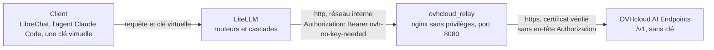

<!--
SPDX-FileCopyrightText: 2026 Tigerblue77 and the AI Docker stack Ansible deployment contributors
SPDX-License-Identifier: AGPL-3.0-only
-->

# Le relais OVHcloud

Ce document dit ce qu'est le relais `ovhcloud_relay`, pourquoi il existe, comment il fonctionne, ce qu'il fait de chaque requête, pourquoi chaque réglage de son nginx est ce qu'il est, et comment le tester après un déploiement. Il est tenu à la main. Trois de ses affirmations sont tenues à la configuration par `.github/scripts/check_compose_template.py`, qui échoue sinon : le relais retire l'en-tête `Authorization`, il vérifie le certificat d'OVHcloud, et il attend au moins aussi longtemps que le routeur de LiteLLM. Le reste est du texte qu'une personne relit.

Les mesures sont du **2026-11-24**, faites depuis une adresse de sortie partagée d'un nuage. Les limites de débit d'OVHcloud sont comptées par adresse IP : d'une autre adresse, les chiffres changent.

## En une phrase

OVHcloud AI Endpoints sert ses modèles gratuits à une requête qui n'a **aucun** en-tête `Authorization`, et LiteLLM en envoie toujours un : le relais est un nginx qui se place entre les deux et retire cet en-tête.

## Pourquoi il existe

Le point d'accès d'OVHcloud (`https://oai.endpoints.kepler.ai.cloud.ovh.net/v1`, compatible OpenAI) sert des modèles gratuits sans clé, mais seulement dans un cas précis :

| Requête | Réponse d'OVHcloud |
|---|---|
| Aucun en-tête `Authorization` | `200` |
| `Authorization:` présent mais vide | `400`, « invalid HTTP header (authorization) » |
| `Authorization: Bearer <un jeton factice>` | `403` |

LiteLLM ne sait pas ne pas en envoyer. Ce qui a été essayé, avec la version déployée :

| Essai dans LiteLLM | Résultat |
|---|---|
| `extra_headers: {"Authorization": ""}` | `400`, l'en-tête vide part tel quel |
| `extra_headers: {"Authorization": None}` | erreur de validation pydantic, avant tout appel |
| une `api_key` factice seule | `403` |

Chez Kilo Gateway, l'en-tête vide suffit : c'est la forme que le gabarit lui donne. Chez OVHcloud, rien de ce que LiteLLM sait écrire n'arrive sans en-tête, et chaque entrée `-ovh` échouait donc à chaque passage de cascade : un appel perdu, puis le membre suivant. Un nginx, lui, ne transmet pas un en-tête réglé sur la chaîne vide, et c'est tout ce que le relais a à faire.

Avec le relais, mesuré le même jour :

| Essai | Résultat |
|---|---|
| LiteLLM, puis le relais, puis OVHcloud, Mistral Small 3.2 | `OK` |
| Un appel en flux, Llama 3.3 70B | répond, par morceaux |
| Un jeton factice envoyé au relais | `200`, là où le même jeton envoyé à OVHcloud directement donne `403` |
| Un chemin hors de `/v1` | `404` du relais |

## Comment il fonctionne



Une entrée `-ovh` du `model_list` a pour `api_base` `http://ovhcloud_relay:8080/v1` et pour `api_key` un marqueur littéral : LiteLLM exige une clé, et le relais la jette. Le relais n'est atteint que par LiteLLM, sous le nom de son service, sur le réseau interne du stack : aucun port n'est publié, aucune étiquette de reverse proxy n'est posée.

### Ce que le relais garde, retire et refuse

| | Ce qu'il en fait |
|---|---|
| Le chemin sous `/v1/` et la chaîne de requête | **gardés**, tels quels |
| Le corps de la requête | **gardé**, jusqu'à 64 Mo, sans passer par un fichier |
| La réponse, flux compris | **gardée**, morceau par morceau, sans attendre qu'elle soit complète |
| `Authorization` | **retiré** |
| `Host` | **remplacé** par celui d'OVHcloud, que son certificat et son routage attendent |
| `Connection` | **vidé**, pour que la connexion vers OVHcloud soit réutilisée |
| Les autres en-têtes de la requête (`Content-Type`, `User-Agent`, etc.) | gardés |
| `X-Forwarded-For` et ses semblables | **jamais ajoutés** : OVHcloud ne voit que l'adresse de sortie de la machine |
| `/healthz` | **répondu par le relais lui-même** (`200 ok`), sans appeler OVHcloud |
| `/v1` sans barre finale, et tout chemin hors de `/v1/` | **refusés** : `404` |
| Un corps de plus de 64 Mo | **refusé** : `413` |
| Un OVHcloud injoignable | échec après 10 s, que le routeur de LiteLLM traite comme celui de n'importe quel membre |

## Les réglages de nginx, un par un

Le fichier est `files/ovhcloud_relay/nginx.conf`, monté sur le `default.conf` de l'image.

| Réglage | Pourquoi |
|---|---|
| `proxy_set_header Authorization ""` | **Le relais tout entier.** nginx ne transmet pas un en-tête dont la valeur est la chaîne vide : c'est ainsi qu'on en retire un, et c'est ce qu'OVHcloud demande. |
| `proxy_ssl_verify on`, `proxy_ssl_trusted_certificate /etc/ssl/certs/ca-certificates.crt` | Sans ces deux lignes nginx n'authentifie pas le serveur auquel il parle en TLS : le relais enverrait les requêtes à n'importe quel serveur qui présente un certificat. Le fichier est le jeu d'autorités que l'image installe. |
| `proxy_ssl_server_name on`, `proxy_ssl_name $ovh` | Le nom d'OVHcloud est envoyé dans la poignée de main TLS (SNI), ce que nginx ne fait pas de lui-même, et c'est contre ce nom que le certificat est vérifié. |
| `resolver 127.0.0.11 valid=300s ipv6=off`, `set $ovh …`, `proxy_pass https://$ovh` | Le nom d'OVHcloud est dans une variable : nginx le résout alors **à chaque requête**, avec ce délai de validité, et non une fois au démarrage. Deux conséquences voulues : le relais démarre même quand OVHcloud est injoignable (les tâches de CI qui déploient le stack n'ont pas toutes d'Internet), et il suit un changement d'adresse d'OVHcloud sans redémarrer. `127.0.0.11` est le DNS intégré de Docker, à la même adresse dans tout conteneur d'un réseau défini par l'utilisateur ; `ipv6=off` parce que le serveur n'écoute qu'en IPv4. |
| `proxy_set_header Host $ovh` | OVHcloud attend son propre nom, et non `ovhcloud_relay:8080`. |
| `proxy_http_version 1.1`, `proxy_set_header Connection ""` | Des connexions persistantes vers OVHcloud : la poignée de main TLS n'est pas refaite à chaque requête, et un flux est possible. |
| `proxy_buffering off` | Une réponse en flux est transmise morceau par morceau. Gardée en mémoire ou dans un fichier, elle n'arriverait qu'à la fin, et le délai d'attente du routeur la couperait avant. |
| `proxy_request_buffering off` | Le corps de la requête part vers OVHcloud à mesure qu'il arrive, et n'est jamais écrit dans le `/tmp` du conteneur, un tmpfs de 16 Mio qui se remplirait avec une requête qui porte des images. |
| `client_max_body_size 64m` | Une requête qui porte plusieurs images les porte en base64 (un tiers de plus que les images) dans un seul corps JSON. La limite par défaut de nginx, 1 Mo, répondrait `413` à la première photographie. |
| `proxy_read_timeout 300s` | **Au moins** le `timeout` du routeur de LiteLLM (120 s, 90 s pour un flux) : un relais qui abandonne avant le routeur transforme un modèle lent en erreur que le routeur n'aurait pas levée. `check_compose_template.py` tient le relais à cette règle. |
| `proxy_connect_timeout 10s` | OVHcloud injoignable échoue vite, et la cascade passe au membre suivant, au lieu d'attendre le délai par défaut de 60 s. |
| `location = /healthz` avec `access_log off` | Ce que la vérification de santé du conteneur appelle. Le relais répond lui-même : un OVHcloud en panne ou qui répond `429` ne rend pas le relais malsain, et une sonde toutes les trente secondes ne coûte rien du quota gratuit, compté par modèle et par adresse. Sans `access_log`, parce que ces lignes noieraient les vraies. |
| `location = /v1` et `location /` en `404` | Le relais ne sert que `/v1/`. Sans la première, nginx redirigerait `/v1` vers `/v1/` (301), ce qui est inoffensif mais n'est pas un refus. |
| `listen 8080` | Le port que l'image sans privilèges écoute déjà, et que l'`api_base` des entrées nomme. IPv4 seulement, d'où `127.0.0.1` dans la vérification de santé. |

## Sécurité

| | |
|---|---|
| Aucun secret | Le fichier n'en contient pas, et `ovh-no-key-needed` n'en est pas un : c'est le marqueur que LiteLLM exige, jeté par le relais. |
| Aucun port publié | Seule la passerelle atteint le relais, sous son nom de service. `check_compose_template.py` refuse un `ports:`, une étiquette, ou un second réseau. |
| Un seul réseau | Le réseau interne du stack, celui que la passerelle utilise déjà pour ses autres services. Le relais n'a pas de raison d'en voir d'autre. |
| Sans privilèges | L'image est celle que NGINX publie pour tourner sans être root : l'utilisateur est `nginx` (UID 101), le port 8080, le fichier de PID et les fichiers temporaires sont sous `/tmp`. Un processus qui n'est pas root n'a aucune capacité effective : le modèle du template n'en retire aucune par service, et le relais n'en ajoute pas. |
| Système de fichiers en lecture seule | `read_only: true`, avec un tmpfs de 16 Mio sur `/tmp`, que Swarm honore sous la forme longue de `volumes` et ignore sous la clé `tmpfs:`. Rien de ce que nginx écrit n'est ailleurs. |
| Le certificat d'OVHcloud est vérifié | Voir `proxy_ssl_verify` plus haut. Ce qui sort du stack vers OVHcloud est chiffré et adressé à OVHcloud. |
| Ce que le relais ne protège pas | Le corps de chaque requête passe en clair, entre LiteLLM et le relais, sur le réseau interne du stack. Le relais ne le garde nulle part : son journal d'accès porte une ligne par requête (adresse du client, méthode, chemin, code, taille, agent), sans corps et sans `Authorization`. Les groupes de données du `model_list` disent ce qu'OVHcloud fait des données ; le relais n'y change rien. |

L'image est `nginx/nginx-unprivileged`, publiée par NGINX lui-même (dépôt `github.com/nginx/docker-nginx-unprivileged`, image `hub.docker.com/r/nginx/nginx-unprivileged`). Elle remplace `nginxinc/nginx-unprivileged`, son ancienne adresse : Docker Hub la marque archivée (« This registry is no longer maintained »), et elle ne reçoit plus de reconstruction. L'étiquette est celle par défaut, `latest`, qui est la variante Debian de la branche principale, reconstruite chaque semaine ; le Dockerfile de cette variante installe `ca-certificates` et `curl`, que le relais utilise. Pages lues le 2026-11-24.

## Les limites d'OVHcloud, mesurées, et pourquoi on ne lit pas ses en-têtes

Le relais ne change rien aux limites d'OVHcloud : il les subit, par adresse IP et par modèle. Deux observations, qu'il ne faut pas confondre :

- **Depuis le réseau du mainteneur, le 2026-11-22 :** 2 requêtes par minute, par adresse IP et par modèle. Un appel anonyme à gpt-oss-120b a répondu, un second dans la minute a reçu un `429`. Ce chiffre est une observation, écrite sur aucune page lue.
- **Depuis une adresse de sortie partagée d'un nuage, le 2026-11-24 :** Qwen3.5 397B a répondu 8 appels sur 8 (4 d'un coup, 3 une minute après, 1 deux minutes après), ce que 2 par minute n'explique pas ; gpt-oss-20b a répondu `429` à chaque appel pendant plusieurs minutes.

Chaque réponse d'OVHcloud, `200` comprises, porte `ratelimit-limit: 1` et `x-ratelimit-limit-year: 1`. Les `200` contredisent ces en-têtes : ils ne décrivent pas la limite réellement appliquée, et **aucun chiffre du dépôt n'en est tiré**. La limite d'un modèle est ce qu'une adresse a pu obtenir ce jour-là, pas ce qu'OVHcloud annonce. Les routeurs qui portent des entrées `-ovh` les traitent donc comme un dernier recours gratuit, derrière tout membre gratuit et devant les membres payants (`ROUTAGE.md` dit où chacune est placée).

Une conséquence qui tient au relais : toute la maison sort par l'adresse de la machine, donc par un seul compteur par modèle, et le relais n'ajoute aucun en-tête qui permettrait de distinguer les appelants.

## Ce qui est laissé de côté

La clé payante d'OVHcloud. Avec une clé le plafond passe à 400 requêtes par minute, mais une clé exige un moyen de paiement sur un projet Public Cloud et aucun plafond de dépense n'existe : le critère de la carte n'est pas rempli. Le registre des fournisseurs du `README.md` l'a déjà écartée, avec sa raison, et le relais n'y change rien : avec une clé, l'en-tête serait celui qu'OVHcloud attend, et le relais, qui le retire, n'aurait plus de raison d'être.

## Ce qui a été vérifié, et ce qui ne l'a pas été

**Vérifié, le 2026-11-24 :** la configuration livrée dans `files/ovhcloud_relay/nginx.conf` a passé `nginx -t`, puis a été lancée avec un nginx de la distribution (et le résolveur de la machine à la place de `127.0.0.11`, le port d'essai à la place de 8080). Contre un serveur local qui répond ce qu'il a reçu : l'en-tête `Authorization` n'arrive pas, l'en-tête `Host` est celui d'OVHcloud, aucun `X-Forwarded-For` n'est ajouté, un corps de 40 Mo passe et un de 70 Mo répond `413`, un flux dont les morceaux sont espacés de 1,5 s arrive espacé de 1,5 s (rien n'est retenu), `/v1/` passe, `/v1` et un autre chemin répondent `404`, et `/healthz` répond `200`. Contre OVHcloud, un appel direct avec un jeton factice a répondu `200` (Mistral Small 3.2 : `OK`), et un appel en flux depuis LiteLLM a répondu `200`.

**Non vérifié :** le conteneur lui-même. Aucune machine d'essai n'avait Docker : ni le démarrage de l'image, ni son point d'entrée avec un système de fichiers en lecture seule, ni le tmpfs, ni le DNS intégré à `127.0.0.11`, ni le comportement sous Swarm n'ont été exécutés. Les tâches « role run » de la CI déploient le stack et sont ce qui le dira ; la commande ci-dessous le dit sur la machine réelle.

## Tester après un déploiement

À lancer sur l'hôte Docker. Elle s'exécute **dans** le conteneur de LiteLLM, d'où la clé maîtresse ne sort pas : elle y est lue dans l'environnement du conteneur et n'est jamais affichée. Elle appelle le relais, puis la passerelle sur une entrée OVHcloud par son nom, ce qui ne passe par aucune cascade : un échec est celui de cette entrée seule.

```bash
docker exec -i "$(docker ps -q --filter name=litellm --filter status=running | head -n1)" python - <<'PY'
import json, os, time, urllib.error, urllib.request


def call(url, payload=None, headers=None):
    request = urllib.request.Request(url, data=json.dumps(payload).encode() if payload else None, headers=headers or {})
    started = time.time()
    try:
        with urllib.request.urlopen(request, timeout=120) as response:
            return response.status, response.read().decode(), time.time() - started
    except urllib.error.HTTPError as error:
        return error.code, error.read().decode(), time.time() - started


status, _, _ = call("http://ovhcloud_relay:8080/healthz")
print("relay /healthz        :", status)
status, body, seconds = call(
    "http://localhost:4000/v1/chat/completions",
    {"model": "mistral-small-3-2-ovh", "max_tokens": 8, "messages": [{"role": "user", "content": "Reply with the single word OK."}]},
    {"Content-Type": "application/json", "Authorization": "Bearer " + os.environ["LITELLM_MASTER_KEY"]},
)
try:
    answer = json.loads(body)["choices"][0]["message"]["content"]
except (KeyError, IndexError, ValueError):
    answer = body[:300]
print("mistral-small-3-2-ovh  : %s in %.1f s, answer %r" % (status, seconds, answer))
PY
```

Ce qu'il faut lire :

| Sortie | Ce que cela dit |
|---|---|
| `relay /healthz : 200` et `mistral-small-3-2-ovh : 200 … answer 'OK'` | Tout marche : la requête est passée par le relais, qui a retiré l'en-tête, et OVHcloud l'a servie. |
| `relay /healthz` en erreur de connexion | Le relais ne tourne pas, ou le nom `ovhcloud_relay` ne résout pas depuis LiteLLM : voir ci-dessous. |
| `relay /healthz : 200` et `429` de l'entrée | Le relais marche, et c'est la limite d'OVHcloud pour ce modèle depuis cette adresse. Réessayer au bout d'une minute, ou changer d'entrée. |
| `relay /healthz : 200` et `400` ou `403` de l'entrée | L'en-tête arrive jusqu'à OVHcloud : l'entrée ne passe pas par le relais (son `api_base` est celle d'OVHcloud), ou le relais ne retire plus l'en-tête. `check_compose_template.py` l'aurait refusé : relire le `model_list` rendu. |
| `404` de l'entrée, venu de LiteLLM | Le nom de l'entrée n'existe pas dans la configuration rendue. |

Pour voir ce que le relais a servi depuis dix minutes, sans rien d'autre que les codes et leur nombre :

```bash
docker logs --since 10m "$(docker ps -q --filter name=ovhcloud_relay --filter status=running | head -n1)" 2>&1 | grep -o '" [0-9][0-9][0-9] ' | sort | uniq -c
```

Un `200` par appel réussi, un `429` par refus d'OVHcloud, un `404` pour un chemin hors de `/v1/`, et jamais un `403` ni un `400` : ceux-là seraient ceux d'OVHcloud, donc un en-tête qui n'a pas été retiré.
